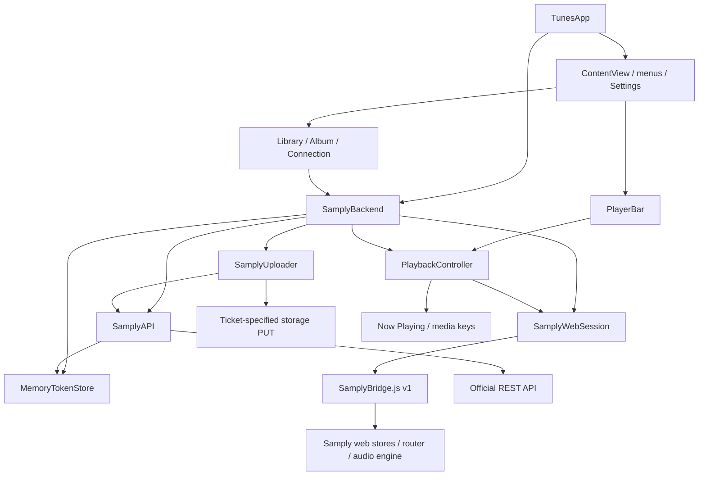

# Tunes architecture and code navigation

## Architectural approach

Tunes is a native macOS client: SwiftUI/AppKit handle browsing and interaction, while a single app-owned `WKWebView` handles Samply sign-in and authenticated streaming. The complete Library, including shared content, comes from the web session. The official REST API provides a separate integration path, currently used mainly for optional original-file uploads.

The repository uses a feature-oriented single-app architecture. `App`, `Features`, and `Samply` are directory and responsibility boundaries, **not separate Swift modules or frameworks**. They compile into the same Tunes target, and directories do not enforce dependency direction. The current scope does not require additional packages, a generic Repository layer, or another playback engine.

## Directory layout

```text
Tunes/
├── App/                         App entry point, scenes, and cross-feature coordination
│   ├── TunesApp.swift           Creates the shared backend; configures windows, Settings, and menus
│   ├── ContentView.swift        Main interface, navigation, toolbar, upload status, and recovery task
│   ├── SamplyBackend.swift      Dependency assembly and account, browsing, playback, and upload coordination
│   └── SamplyPageFocus.swift    Exposes the current page to menus through SwiftUI FocusedValues
├── Features/
│   ├── Library/                 Library grid, search, and selection callbacks
│   ├── Album/                   Albums, folders, tracks, versions, and presentation calculations
│   │   └── Kaset/              Kaset-derived album components
│   ├── Playback/               PlaybackController, player bar, and interactions
│   │   └── Kaset/              Player components, artwork cache, and seek/volume interactions
│   ├── Connection/             Connection settings, email-link input, and WebKit window container
│   └── About/                  About window and menu commands
├── Samply/
│   ├── Web/                    WebKit session, bridge health, page targets, and snapshot models
│   ├── REST/                   Official HTTP API, request/response models, and original-file uploads
│   ├── Authentication/         In-memory TokenStore and email-link conversion
│   └── SamplyError.swift       Errors shared by both integration paths
├── Resources/
│   ├── SamplyBridge.js         v1 adapter; sole entry point for undocumented web contracts
│   └── Kaset-LICENSE.txt        License distributed with the app
├── Assets.xcassets/             Native assets
└── AppIcon.icon/               App icon

TunesTests/                     Swift unit and simulated-network tests
Scripts/test-samply-bridge.mjs   Node bridge protocol tests
TunesUITests/                   Legacy Xcode UI test template; excluded from project validation
Docs/                           Architecture, integration constraints, and attribution
```

Xcode uses `PBXFileSystemSynchronizedRootGroup` to collect source files automatically. These moves do not require individual file-reference changes in `project.pbxproj`; place new Swift files in the appropriate responsibility directory. `Resources/SamplyBridge.js` keeps its path so the app can load it by resource name and Node tests can read it.

The `Kaset` subdirectories identify third-party provenance and adapted components, rather than a separate business layer. Preserve provenance comments and maintain [ThirdPartyNotices.md](ThirdPartyNotices.md) when editing them.

## Runtime relationships



The diagram shows the main calls. Connection views also call `SamplyWebSession` directly to show its window, open an email link, or open token preferences. `SamplyWebSession` currently creates an `NSHostingView` containing `Features/Connection/SamplyWebWindowView`: window lifecycle and web-session management remain coupled, so `Samply/Web` is not a UI-independent infrastructure module.

## State ownership and lifecycle

| Owner | State and responsibilities | Update source |
| --- | --- | --- |
| `TunesApp` | One app-wide `SamplyBackend` | `@State` shares it across scenes |
| `SamplyBackend` | Library, selected album/folder, tracks, loading/operation state; assembles web, api, playback, and uploader | Snapshot polling and explicit command results |
| `SamplyWebSession` | Main WebView, persistent website data store, sign-in window/pop-ups, authentication state, latest snapshot, and bridge health | WebKit navigation and bridge calls |
| `PlaybackController` | Native playback snapshot, errors, and system media controls | Web playback snapshots and command results |
| `SamplyUploader` | Single upload task, progress, status, and resulting box ID | Upload-ticket creation, file PUT, and delegate callbacks |
| `MemoryTokenStore` | Optional PAT | Explicit user submission after API verification; process memory only |
| SwiftUI views | Search, presentations, temporary inputs, and interaction animations | User interaction and observable business state |

The main coordinating objects use `@MainActor`; observable state uses Observation. Network and WebKit operations use `async/await`, and the upload delegate delivers progress to the main actor. Samply's media clock is authoritative for playback position; native dragging, hold gestures, and progress presentation must not become the source of truth for media state.

`SamplyBackend.start()` starts one monitoring task: call `web.refresh()`, accept a trusted snapshot, then wait according to bridge health. Normal polling uses 700 milliseconds; the first 10 seconds of read failures use 250 milliseconds. A bridge read error appears only after 5 seconds of continuous failure. Hosted unit tests skip monitoring startup and real Samply navigation.

## Key data flows

### Sign-in and account changes

1. A native entry point shows the existing Samply window. Hiding the window preserves the same WebView and media engine.
2. The user requests a sign-in email on that page and pastes the complete link. Input is converted to a URL and opened in the same WebView. The link is not preflighted, dissected, logged, or persisted; the website handles email-provider redirects.
3. The bridge returns a `WebSnapshot`; its account and authentication state drive the native UI. A missing account does not immediately mean sign-out: only an explicit `signedOut` establishes that the user is signed out.
4. When a known account changes, the backend cancels old selection tasks and clears page, playback, upload, and old PAT state. Explicit sign-out also clears that build's WebKit website data.

Debug uses `com.lloydME.Tunes.beta`; Release uses `com.lloydME.Tunes`. Their WebKit store UUIDs differ. PATs and web sign-in are independent: successful REST token validation neither establishes a web-player session nor proves that the token belongs to the current web account. Connection settings require the user to provide a token for the same account.

Default-browser authorization still requires an officially registered client and a supported full Library/player session handoff. The repository does not implement an authorization service or expose an unavailable entry point. See [AuthenticationDesign.md](AuthenticationDesign.md).

### Browsing, folders, and versions

```mermaid
sequenceDiagram
    participant V as Library / Album View
    participant B as SamplyBackend
    participant W as SamplyWebSession
    participant J as SamplyBridge.js
    V->>B: select / openFolder / goUp
    B->>B: Cancel old browseTask; update selectionGeneration
    B->>W: call("browse", routeID, groupID)
    W->>J: Call command with arguments
    J->>J: Navigate and wait for player / boxes readiness
    J-->>W: WebSnapshot
    W-->>B: Codable snapshot
    B->>B: Check task, selection generation, route, and level
    B-->>V: boxes + AlbumLoadState
```

`LibraryItem.routeID` prefers a share ID, then a player/project ID. The complete Library cannot be replaced with the REST owned-projects list.

`WebSnapshot.hasLoadedBoxes` in `SamplyWebModels.swift` centralizes album readiness checks. `AlbumContents` only calculates tracks, folders, duration, and presentation text. The `versions` command retrieves versions according to Samply's own access rules. An unloaded empty array must not be presented as a confirmed empty album.

### Playback and system controls

Track selection goes through `SamplyBackend.play`, which checks that the album is loaded and the file is playable and not processing, then calls `playBox`. The adapter uses Samply's own `audio-module.loadBox` and authorized context. Samply continues to own audio URLs, formats, quality, permissions, and gapless playback.

The player bar and media keys share `PlaybackController.perform`, sending play, pause, previous/next, seek, volume, and quality commands through the bridge. Command playback snapshots and subsequent polling update the same `PlaybackController.state`, which then updates `MPNowPlayingInfoCenter`. Tunes has no native decoder and does not extract streaming URLs or fall back to download URLs.

### Refresh and error recovery

`SamplyPage` represents the Library, album, or folder target for both toolbar and menu actions. SwiftUI focus propagation lives in `App/SamplyPageFocus.swift`.

`refreshPage` updates current-page data while preserving the existing list until success. It neither reloads the WebView nor invokes audio operations. `navigatePage` navigates to the corresponding web page and shows the same Samply window.

`ContentView` owns a recovery task that cancels when the page or recovery requirement changes. It calls `backend.recover` with backoff from 250 milliseconds to 2 seconds. Recovery retries reads only; it never replays playback, seek, or upload operations. Explicit permission denials and contract errors are not treated as automatically recoverable transient failures.

### Optional original-file uploads

`ConnectionView → backend.saveToken → SamplyAPI.projects(token:) → MemoryTokenStore` validates the PAT. `backend.chooseUpload` selects one original file and passes it to `SamplyUploader`:

1. Hold the file's security scope and read its size, modification time, and MIME type.
2. Use the PAT to request an upload ticket from the official REST API; do not automatically replay the POST.
3. Recheck the file, then PUT it from disk using a separate storage session without a PAT or cookies, including the metadata required by the ticket.
4. Use an operation ID to discard progress/completion callbacks after cancellation or reset.

A successful PUT only confirms data submission; Samply may still be processing it. The API's download-ticket query capability is not connected to playback.

## Integration contracts and concurrency boundaries

- `Resources/SamplyBridge.js` encapsulates all undocumented web store/router contracts. Swift consumes Codable models and explicit commands without accessing web internals elsewhere.
- The bridge entry point is `window.__tunesSamply`, currently version 1. Snapshot polling checks the version; an unknown version must not silently drive native state. Arguments use `callAsyncJavaScript(arguments:)` rather than script interpolation.
- The bridge installs only in Samply's HTTPS top-level document. Email-link navigation does not apply the bridge's origin checks.
- The backend's `selectionGeneration` prevents stale selections from overwriting new pages; the web session's `generation` prevents old-document results from overwriting new navigation/sign-out; JavaScript's `operation` invalidates superseded navigation or track selection; the uploader's operation ID isolates upload callbacks. Preserve these checks when changing asynchronous flows.
- Web exceptions map to fixed error categories across the bridge so arbitrary page errors cannot expose URLs containing credentials. PATs never enter JavaScript, files, preferences, or logs. Application code does not access the Keychain.

See [SamplyBackend.md](SamplyBackend.md) for web stores, refresh implementation, and official REST behavior.

## Change guide and verification

| Change | Primary location | Existing verification |
| --- | --- | --- |
| Scenes, menus, cross-page actions | `App/` | `SamplyPageTests` + manual checks |
| Album readiness, grouping, metadata | `Samply/Web/SamplyWebModels.swift`, `Features/Album/` | `AlbumContentsTests` |
| Player bar and artwork | `Features/Playback/`, `Features/Album/Kaset/` | `PlayerBarSeekHoldTests`, `AlbumPaletteTests` + manual checks |
| Web contracts, controls, refresh | `Resources/SamplyBridge.js`, `Samply/Web/` | Node protocol tests, `SamplyBridgeHealthTests`, `PlaybackRecoveryTests` |
| Email sign-in and authentication state | `Features/Connection/`, `Samply/Authentication/`, `Samply/Web/` | `EmailSignInLinkTests` (in `TunesTests.swift`), `WebAuthenticationStateTests` |
| REST, PATs, uploads | `Samply/REST/`, `Samply/Authentication/TokenStore.swift` | Mock URLProtocol tests in `TunesTests.swift` |

Build and test commands are in the [README](../README.md#verification). Run only `TunesTests` and Node protocol tests. `TunesUITests` is a legacy template containing app-launch code; do not run it. Computer Use, browser automation, UI tests, and screenshots of the running app are prohibited for validation.

The user must manually verify real Samply sign-in, shared content, playback, seeking, and uploads with instructions provided in chat. Passing simulated tests does not establish real-world end-to-end web compatibility.

## When to split responsibilities further

Two couplings remain explicit: `SamplyBackend` combines dependency assembly with cross-feature state coordination, and `SamplyWebSession` combines window ownership with web communication. If features grow or more isolated testing is needed, extract browsing/upload coordinators, a window host, and an injectable web-session protocol. This directory cleanup introduces none of those currently unnecessary abstractions and does not change sign-in, permissions, or playback behavior.
