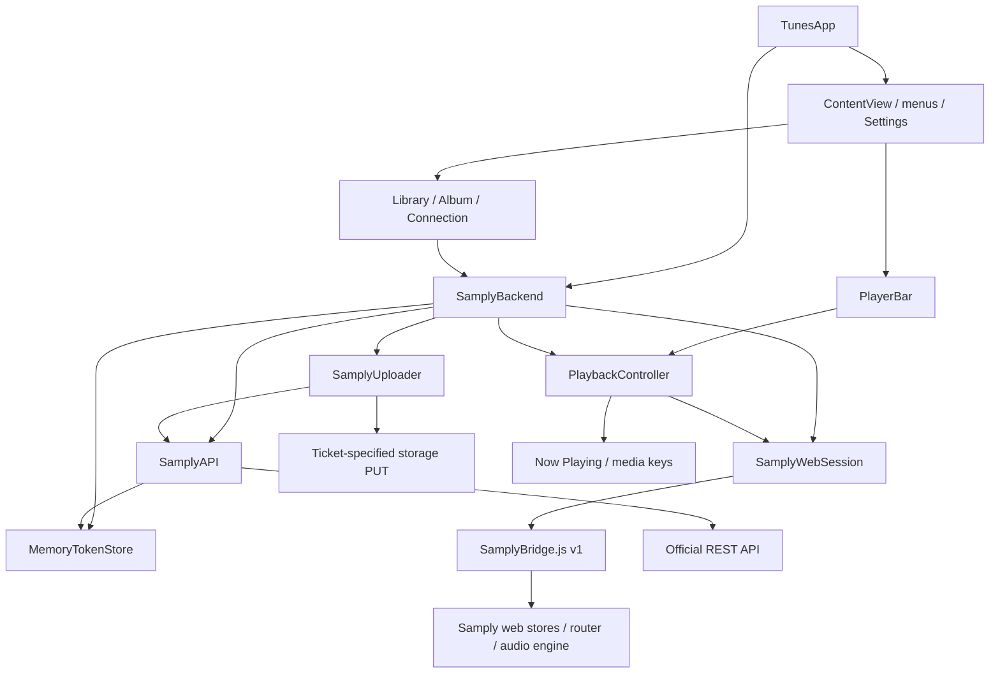

# Tunes architecture and code navigation

## Architectural approach

Tunes is a native macOS client: SwiftUI/AppKit handle browsing and interaction, while a single app-owned `WKWebView` handles Samply sign-in and authenticated streaming. The complete Library, including shared content, comes from the web session. The official REST API provides a separate integration path for empty-project creation and optional original-file uploads.

The repository uses a feature-oriented single-app architecture. `App`, `Features`, and `Samply` are directory and responsibility boundaries, **not separate Swift modules or frameworks**. They compile into the same Tunes target, and directories do not enforce dependency direction. The current scope does not require additional packages, a generic Repository layer, or another playback engine.

## Directory layout

```text
Tunes/
├── App/                         App entry point, scenes, and cross-feature coordination
│   ├── TunesApp.swift           Creates the shared backend; configures windows, Settings, and menus
│   ├── ContentView.swift        Main interface, navigation, toolbar, upload status, and recovery task
│   ├── SamplyBackend.swift      Dependency assembly and account, browsing, playback, creation, and upload coordination
│   └── SamplyPageFocus.swift    Exposes the current page to menus through SwiftUI FocusedValues
├── Features/
│   ├── Library/                 Library grid, search, selection, project creation, artwork staging, and creation sheet
│   ├── Album/                   Albums, folders, tracks, versions, and presentation calculations
│   │   └── Kaset/              Kaset-derived album components
│   ├── Playback/               PlaybackController, player bar, and interactions
│   │   └── Kaset/              Player components, artwork cache, and seek/volume interactions
│   ├── Connection/             Connection settings, email-link input, and WebKit window container
│   └── About/                  About window and menu commands
├── Samply/
│   ├── Web/                    WebKit session, bridge health, page targets, and snapshot models
│   ├── REST/                   Official HTTP API, request/response models, project creation, and original-file uploads
│   ├── Authentication/         Account-bound file TokenStore and email-link conversion
│   └── SamplyError.swift       Errors shared by both integration paths
├── Resources/
│   ├── SamplyBridge.js         v1 adapter; sole entry point for undocumented web contracts
│   └── Kaset-LICENSE.txt        License distributed with the app
├── Assets.xcassets/             Native assets
└── AppIcon.icon/               App icon

TunesTests/                     Swift unit and simulated-network tests
Scripts/test-samply-bridge.mjs   Node bridge protocol tests
TunesUITests/                   Legacy Xcode UI test template; excluded from project validation
Docs/                           Architecture, integration constraints, and attribution
```

Xcode uses `PBXFileSystemSynchronizedRootGroup` to collect source files automatically. These moves do not require individual file-reference changes in `project.pbxproj`; place new Swift files in the appropriate responsibility directory. `Resources/SamplyBridge.js` keeps its path so the app can load it by resource name and Node tests can read it.

The `Kaset` subdirectories identify third-party provenance and adapted components, rather than a separate business layer. Preserve provenance comments and maintain [ThirdPartyNotices.md](ThirdPartyNotices.md) when editing them.

## Runtime relationships



The diagram shows the main calls. Connection views also call `SamplyWebSession` directly to show its window, open an email link, or open token preferences. `SamplyWebSession` currently creates an `NSHostingView` containing `Features/Connection/SamplyWebWindowView`: window lifecycle and web-session management remain coupled, so `Samply/Web` is not a UI-independent infrastructure module.

## State ownership and lifecycle

| Owner | State and responsibilities | Update source |
| --- | --- | --- |
| `TunesApp` | One app-wide `SamplyBackend` | `@State` shares it across scenes |
| `SamplyBackend` | Library, selected album/folder, tracks, loading/operation state, creation owner; assembles web, api, playback, uploader, and project creation | Snapshot polling and explicit command results |
| `ProjectCreationCoordinator` | Single creation request, verified credential/mutation contexts, quarantined result, ordered file uploads with phase outcomes, REST artwork submission, Library-refresh stage, and recovery state | REST creation/upload results, adapter refresh/browse/ownership results, and account/credential invalidation |
| `ProjectCredentialAuthority` | Explicit absent/validating/verified/rejected/unverifiable PAT state bound to an account session generation and credential revision | Owned-project list, authenticated project-ownership read, token store, and account changes |
| `SamplyWebSession` | Main WebView, persistent website data store, sign-in window/pop-ups, authentication state, latest snapshot, and bridge health | WebKit navigation and bridge calls |
| `PlaybackController` | Native playback snapshot, errors, and system media controls | Web playback snapshots and command results |
| `SamplyUploader` | Single upload task, progress, status, and resulting box ID | Upload-ticket creation, file PUT, and delegate callbacks |
| `FileTokenStore` | Optional PAT | Explicit user submission after API verification; local plaintext file, restored only for a matching web account |
| SwiftUI views | Search, presentations, temporary inputs, and interaction animations | User interaction and observable business state |

The main coordinating objects use `@MainActor`; observable state uses Observation. Network and WebKit operations use `async/await`, and the upload delegate delivers progress to the main actor. Samply's media clock is authoritative for playback position; native dragging, hold gestures, and progress presentation must not become the source of truth for media state.

`SamplyBackend.start()` starts one monitoring task: call `web.refresh()`, accept a trusted snapshot, then wait according to bridge health. Normal polling uses 700 milliseconds; the first 10 seconds of read failures use 250 milliseconds. A bridge read error appears only after 5 seconds of continuous failure. Hosted unit tests skip monitoring startup and real Samply navigation.

## Key data flows

### Sign-in and account changes

1. A native entry point shows the existing Samply window. Hiding the window preserves the same WebView and media engine.
2. The user requests a sign-in email on that page and pastes the complete link. Input is converted to a URL and opened in the same WebView. The link is not preflighted, dissected, logged, or persisted; the website handles email-provider redirects.
3. The bridge returns a `WebSnapshot`; its account and authentication state drive the native UI. A missing account does not immediately mean sign-out: only an explicit `signedOut` establishes that the user is signed out.
4. When a known account changes, the backend cancels old selection tasks and clears page, playback, upload, and old PAT state. Explicit sign-out also clears that build's WebKit website data.

Debug uses `com.lloydME.Tunes.beta`; Release uses `com.lloydME.Tunes`. Their WebKit store UUIDs differ. PATs and web sign-in are independent: a successful `GET /projects` proves only that the token works. Tunes also requires the documented owned-project list to contain a project that an authenticated web read shows is currently owned by the signed-in UID. That binds the token to the web account without inventing an identity endpoint or decoding the PAT. Empty owned-project lists are reported as unverifiable rather than bypassed: Samply documents no identity endpoint, and Tunes will not create a disposable project to discover ownership. This means a brand-new account cannot create its first project in Tunes until it has an owned project created elsewhere (for example, on Samply's website). See [SamplyBackend.md](SamplyBackend.md).

Default-browser authorization still requires an officially registered client and a supported full Library/player session handoff. The repository does not implement an authorization service or expose an unavailable entry point. See [AuthenticationDesign.md](AuthenticationDesign.md).

### Browsing, folders, and versions

```mermaid
sequenceDiagram
    participant V as Library / Album View
    participant B as SamplyBackend
    participant W as SamplyWebSession
    participant J as SamplyBridge.js
    V->>B: select / openFolder / goUp
    B->>B: Cancel old browseTask; update selectionGeneration
    B->>W: call("browse", routeID, groupID)
    W->>J: Call command with arguments
    J->>J: Navigate and wait for player / boxes readiness
    J-->>W: WebSnapshot
    W-->>B: Codable snapshot
    B->>B: Check task, selection generation, route, and level
    B-->>V: boxes + AlbumLoadState
```

`LibraryItem.routeID` prefers a share ID, then a player/project ID. The complete Library cannot be replaced with the REST owned-projects list.

`WebSnapshot.hasLoadedBoxes` in `SamplyWebModels.swift` centralizes album readiness checks. `AlbumContents` only calculates tracks, folders, duration, and presentation text. The `versions` command retrieves versions according to Samply's own access rules. An unloaded empty array must not be presented as a confirmed empty album.

### Empty project creation

The Library toolbar opens a native creation sheet backed by `SamplyBackend.projectCreation`. The coordinator captures the web account and a creation operation before starting, rejects a blank trimmed name, and allows only one POST at a time. The request sends only `name` to the documented `POST /projects` endpoint. Samply's documented server side effect creates a project-scoped player with the account's default player options; Tunes sends no player, sharing, upload, download, version, collaborator, or upload-portal settings and makes no separate player-creation request.

```mermaid
sequenceDiagram
    participant V as NewProjectSheet
    participant B as SamplyBackend / ProjectCreationCoordinator
    participant A as SamplyAPI
    participant S as Storage
    participant W as SamplyWebSession
    participant J as SamplyBridge.js
    V->>B: create(name, artwork?, files[])
    B->>B: Require verified credential + capture operation
    B->>A: POST /projects {name}
    A-->>B: Project object + creator UID + playerUrl
    B->>B: Compare creator UID; retain or quarantine
    par Optional stages
        B->>A: POST /projects/:id/artwork ticket
        A-->>B: Artwork ticket + box ID
        B->>S: PUT image with x-goog-meta-writeback
        S-->>B: Bytes accepted; assignment pending
    and Ordered file uploads
        B->>A: Upload tickets and streamed PUTs
        A-->>B: Per-file phase outcomes
    end
    B->>W: call("refreshPage", library)
    W->>J: Complete authenticated history read
    J-->>W: WebSnapshot
    W-->>B: Library including shared projects
    opt Explicit user opens the confirmed project
        B->>W: call("browse", playerUrl path + token, projectID)
        W->>J: Existing /p/<identity> navigation
        J-->>W: Loaded album snapshot, including empty boxes
        W-->>B: Open result with live share route
    end
    B-->>V: Independent stage outcomes
```

The POST is never automatically retried. Timeouts, connection loss, cancellation, 5xx responses, and malformed success responses are ambiguous: the project may exist. The sheet then explains that possibility and offers a read-only Library refresh before another attempt. Before any optional write, the response's documented `creator.uid` must match the account that was verified before creation. A missing or mismatched creator UID retains a quarantined project result, starts zero artwork/file writes, and explains that a remote project may exist; it never repeats the POST or deletes remote content. A confirmed creation outlives later artwork, upload, or refresh failures; retries never repeat the project POST and never delete completed remote work. The sheet returns to Library instead of opening the new project. Artwork and files added after creation are independent outcomes. Files upload one at a time from the confirmed project ID without waiting for player navigation; successful files remain successful when a later file fails. A ticket request, ticket receipt, PUT start, and successful PUT are distinct phases. Cancellation before any request is safely retryable; later uncertainty retains the ticket identity and is not given a replacement ticket automatically. A successful storage response wins over a racing cancellation.

The documented player link may use a path identity different from the live share identity and carry the share in a `token` query. The adapter sends both, lets Samply's player view resolve the link, and then requires the loaded player's project ID to match. Empty boxes are accepted only after the player and files stores report readiness and publish an empty view-model array. If the complete Library has not yet included the new history entry, the coordinator retains the confirmed player link for any later explicit open. Creation itself stays on Library and does not navigate to the project. Closing the sheet during refresh, delay, or refresh failure retains the confirmed project ID, player URL, account context, and outcome state in the backend. Recovery offers an explicit Library refresh, an explicit open when a route exists, and deliberate local abandonment only after the project has appeared in Library and no refresh/open is pending. Recovery never fabricates a Library item or repeats the POST. Sign-out or account changes invalidate stale completions and cancel pending artwork/upload callbacks. A token replacement cancels pending submissions but does not discard an already confirmed project; task completion is checked against a run identity so an old `defer` cannot clear a newer operation. The WebView is not reloaded and playback is not reset during creation.

### Playback and system controls

Track selection goes through `SamplyBackend.play`, which checks that the album is loaded and the file is playable and not processing, then calls `playBox`. The adapter uses Samply's own `audio-module.loadBox` and authorized context. Samply continues to own audio URLs, formats, quality, permissions, and gapless playback.

The player bar and media keys share `PlaybackController.perform`, sending play, pause, previous/next, seek, volume, and quality commands through the bridge. Command playback snapshots and subsequent polling update the same `PlaybackController.state`, which then updates `MPNowPlayingInfoCenter`. Tunes has no native decoder and does not extract streaming URLs or fall back to download URLs.

The player bar's artwork and artwork glow use the playing `LibraryItem.artwork`, matching the Library card. Native track selection binds that Library entry to playback. Snapshot updates keep it independent of the currently browsed album, refresh its artwork when Library data changes, and can resolve a new playback origin when the playing file belongs to the loaded route. Clearing playback clears the binding. Embedded track artwork is not used as a fallback.

### Refresh and error recovery

`SamplyPage` represents the Library, album, or folder target for both toolbar and menu actions. SwiftUI focus propagation lives in `App/SamplyPageFocus.swift`.

`refreshPage` updates current-page data while preserving the existing list until success. It neither reloads the WebView nor invokes audio operations. `navigatePage` navigates to the corresponding web page and shows the same Samply window.

`ContentView` owns a recovery task that cancels when the page or recovery requirement changes. It calls `backend.recover` with backoff from 250 milliseconds to 2 seconds. Recovery retries reads only; it never replays playback, seek, or upload operations. Explicit permission denials and contract errors are not treated as automatically recoverable transient failures.

### Optional uploads and artwork

`ConnectionView → backend.saveToken → ProjectCredentialAuthority` validates a candidate in memory, proves identity through the owned-project list plus an authenticated project-ownership read, and only then replaces the saved PAT. `backend.chooseUpload` requires a verified credential, captures its token, and passes it to `SamplyUploader`:

1. Hold the file's security scope and read its size, modification time, and MIME type.
2. Use the PAT to request an upload ticket from the official REST API; do not automatically replay the POST.
3. Recheck the file, then PUT it from disk using a separate storage session without a PAT or cookies, including the metadata required by the ticket.
4. Use run and mutation-context identities to discard progress/completion callbacks after cancellation or reset; never reread a replaced PAT halfway through.

Files selected on the New Project file step use the same awaitable upload operation sequentially after the project is confirmed, without waiting for album or player navigation. Each file retains its own progress, ticket identity, phase, definite-failure, cancellation, and uncertain outcome. Upload returns to Library while the queue continues; reopening the sheet exposes in-flight progress and cancellation. Queued cancellation stops later files, marks untouched waiting files cancelled, retains confirmed files, and classifies the active file by its actual phase. Failures are surfaced in a Library notice with safe retry actions, and the confirmed project can be abandoned locally without deleting remote content. Retrying failed files skips completed files and files whose outcome may already exist remotely. The existing album upload remains the visible single-file flow and also retains a successful PUT response over a racing cancellation.

Project artwork now uses the documented REST route: `POST /projects/:projectid/artwork` requests a ticket, then a separate storage session PUTs the prepared image with the required metadata including `x-goog-meta-writeback`. The native sheet still validates and downsamples the image, and only the API request carries the PAT. Ticket metadata, HTTPS storage URL, and image content type are validated before submission. Ticket requests and PUTs have explicit timeouts; a timeout after submission is uncertain, not failed. The uploaded box ID is retained. No documented read exposes a supported relationship proving that box became the project's artwork, so a successful PUT is reported as "submitted; confirmation pending", never as assignment success, and an unrelated artwork change cannot be treated as confirmation.

A successful PUT only confirms data submission; Samply may still be processing it. The API's download-ticket query capability is not connected to playback.

## Integration contracts and concurrency boundaries

- `Resources/SamplyBridge.js` encapsulates all undocumented web store/router contracts. Swift consumes Codable models and explicit commands without accessing web internals elsewhere.
- The bridge entry point is `window.__tunesSamply`, currently version 1. Snapshot polling checks the version; an unknown version must not silently drive native state. Arguments use `callAsyncJavaScript(arguments:)` rather than script interpolation.
- The bridge installs only in Samply's HTTPS top-level document. Email-link navigation does not apply the bridge's origin checks.
- The backend's `selectionGeneration` prevents stale selections from overwriting new pages; the web session's `generation` prevents old-document results from overwriting new navigation/sign-out; JavaScript's `operation` invalidates superseded navigation or track selection; the uploader's operation ID isolates upload callbacks. Preserve these checks when changing asynchronous flows.
- Web exceptions map to fixed error categories across the bridge so arbitrary page errors cannot expose URLs containing credentials. PATs are saved only in the dedicated local plaintext credential file, with a 0700 directory and 0600 file, excluded from backups and isolated by bundle identifier. They never enter JavaScript, preferences, or logs. Application code does not access the Keychain.

See [SamplyBackend.md](SamplyBackend.md) for web stores, refresh implementation, and official REST behavior.

## Change guide and verification

| Change | Primary location | Existing verification |
| --- | --- | --- |
| Scenes, menus, cross-page actions | `App/` | `SamplyPageTests` + manual checks |
| Album readiness, grouping, metadata | `Samply/Web/SamplyWebModels.swift`, `Features/Album/` | `AlbumContentsTests` |
| Player bar and artwork | `Features/Playback/`, `Features/Album/Kaset/` | `PlayerBarSeekHoldTests`, `AlbumPaletteTests` + manual checks |
| Web contracts, controls, refresh | `Resources/SamplyBridge.js`, `Samply/Web/` | Node protocol tests, `SamplyBridgeHealthTests`, `PlaybackRecoveryTests` |
| Email sign-in and authentication state | `Features/Connection/`, `Samply/Authentication/`, `Samply/Web/` | `EmailSignInLinkTests` (in `TunesTests.swift`), `WebAuthenticationStateTests` |
| REST, PATs, project creation, artwork, uploads | `Samply/REST/`, `Features/Library/ProjectCreationCoordinator.swift`, `Features/Library/ProjectArtwork.swift`, `Samply/Authentication/ProjectCredential.swift`, `Samply/Authentication/TokenStore.swift` | Mock URLProtocol tests in `TunesTests.swift` and `SamplyUploaderTests.swift`, credential identity tests in `ProjectCredentialTests.swift`, isolated creation tests in `ProjectCreationTests.swift`, artwork processing tests in `ProjectArtworkTests.swift`; temporary-directory storage tests in `FileTokenStoreTests.swift` |

Build and test commands are in the [README](../README.md#verification). Run only `TunesTests` and Node protocol tests. `TunesUITests` is a legacy template containing app-launch code; do not run it. Computer Use, browser automation, UI tests, and screenshots of the running app are prohibited for validation.

The user must manually verify real Samply sign-in, shared content, playback, seeking, project creation with artwork and uploaded files, empty projects, and uploads with instructions provided in chat. Passing simulated tests does not establish real-world end-to-end web compatibility.

## When to split responsibilities further

Two couplings remain explicit: `SamplyBackend` combines dependency assembly with cross-feature state coordination, and `SamplyWebSession` combines window ownership with web communication. If features grow or more isolated testing is needed, extract browsing/upload coordinators, a window host, and an injectable web-session protocol. This directory cleanup introduces none of those currently unnecessary abstractions and does not change sign-in, permissions, or playback behavior.
