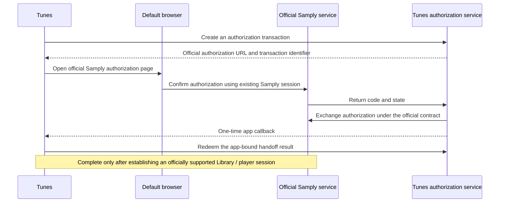

# Official Samply authorization design

Status: the design is agreed, pending official Samply integration requirements. Default-browser sign-in without repeated authentication is not implemented. The app currently retains normal web sign-in in its isolated WebKit session.

The email sign-in completion flow is implemented: request an email on Samply's page inside the app, paste the official email sign-in link back into Tunes, and open it in the same WebKit session for Samply to validate. This uses the website's existing email authentication flow and does not depend on the unprovisioned OAuth integration below. The native input does not read email or browser data.

## User flow

1. Click "Continue in Browser" in Tunes.
2. The default browser opens Samply's official authorization page. If already signed in, confirm authorization there; otherwise, Samply handles sign-in.
3. After authorization succeeds, return to Tunes automatically with the complete Library and working playback.

While waiting, Tunes shows only "Waiting for Samply authorization…" and "Cancel". Cancellation returns to sign-in; failures show a brief reason and "Try Again". Users should not need extensions, bookmark changes, scripts, developer consoles, copied tickets, or callback configuration.

Expose this entry point only when the complete flow works. Obtaining an API token is not a complete account connection, and a supposedly connected user must not need a second player sign-in.

This is the intended future flow. The authorization service and player-session handoff in the diagram have not been deployed.

## Confirmed official capabilities

The [Samply authentication documentation](https://docs.samply.app/api/authentication.html) states that OAuth clients require individual provisioning with a client ID and client secret. User consent returns code/state, which the server exchanges for an API access token.

The public documentation does not describe PKCE for public desktop clients or establish that this API token can sign in to the WebKit player or access the complete shared Library. That documentation alone is therefore insufficient to deliver the promised full sign-in experience. The existing web Library and player depend on the website's own authenticated session.

## Required before integration

- Dedicated official client configuration and an approved authorization route for Tunes. Do not reuse another partner's client ID or impersonate an official client.
- Separately approved Debug and Release callback addresses. Bundle identifiers remain `com.lloydME.Tunes.beta` / `com.lloydME.Tunes`, with isolated transactions and sessions.
- An officially supported complete Library/player session handoff, including scopes, expiry, revocation, and sign-out contracts. REST OAuth alone is insufficient to ship this complete sign-in flow.
- Confirmation of desktop PKCE support. If only the documented confidential-client flow is available, a deployable Tunes server and domain are required, with secrets held server-side only. Never embed a client secret in the desktop binary.

These requirements depend on Samply's client provisioning and service capabilities and cannot be fulfilled within this repository alone. Samply has not been contacted on the user's behalf, and no external service has been registered or deployed.

## Handoff and session boundaries

For a server-mediated flow, Tunes first creates a transaction with a random verifier. The official callback's state must match that transaction exactly. The app callback carries only a short-lived, single-use redemption identifier bound to the initiating app, without API tokens or web credentials. Follow the officially approved callback contract; do not pre-register guessed URL schemes or local listening ports.

Cancellation, timeout, repeated callbacks, and cross-build callbacks must invalidate the transaction. Commit account state only after the initiating app redeems the result. Authorization must not silently replace another signed-in account. Failures must remain retryable without reporting false success.

Keep the current Keychain restriction: application code does not access the local Keychain; API tokens remain in process memory, and each build's WebKit container manages its web session. If the official integration requires additional persistent credentials, redesign storage first rather than silently introducing Keychain access.

Handle Samply authorization only. Do not read browser cookies, long-lived refresh tokens, browser profiles, or Apple identity. Removed approaches must not return as fallback paths.

## Acceptance criteria

Once official integration is available, use simulated protocol tests for success, denial, incorrect state, timeout, cancellation, replay, account mismatch, and cross-build callbacks. The user must manually verify the real flow: authorization in an already signed-in default browser returns automatically and provides owned projects, shared content, and playback; sign-out and revocation follow the official contract. Do not use Computer Use, browser automation, or UI tests.
